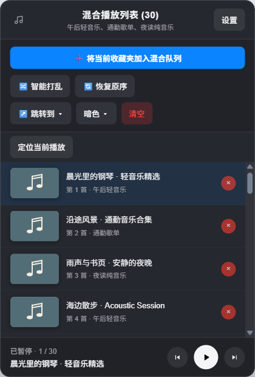
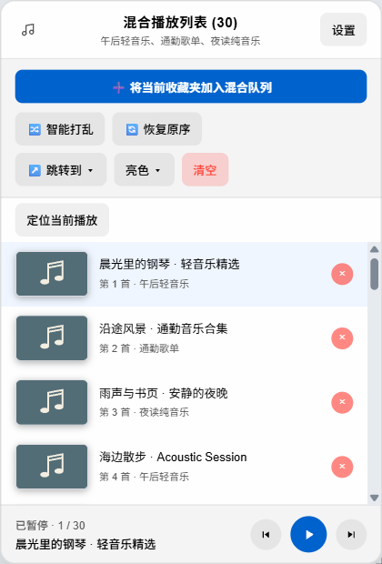
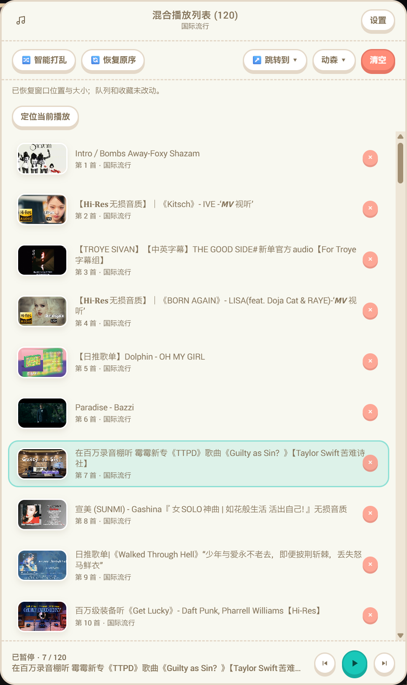

# 🎵 B站收藏夹混合随机播放器

把分散在多个 B站收藏夹里的音乐放进一个队列，一起随机听。点“智能打乱”，当前视频继续播放，其余视频重新排列；同一个 BV 只加入一次，并保留它来自哪些收藏夹。

保留暗色、亮色、动森三套主题，支持悬浮球、窗口尺寸记忆与轻量设置。

**当前 GitHub 版本：[1.4.13](https://github.com/wu66chen/bilibili-mixed-random-player/releases/tag/v1.4.13)。** [下载用户脚本](https://raw.githubusercontent.com/wu66chen/bilibili-mixed-random-player/main/bilibili-mixed-random-player.user.js) · [更新说明](CHANGELOG.md)。Greasy Fork 是独立发布入口，其版本以平台页面为准。

## 📸 三套主题

默认窗口在 1.4.13 中调整为约同等大小（640×1080 CSS 像素），小视口会自动适配。

| 暗色 | 亮色 | 动森 |
| --- | --- | --- |
|  |  |  |

## 🚀 安装与第一次混合播放

1. 安装 [Tampermonkey（篡改猴）](https://www.tampermonkey.net/)，按管理器提示允许脚本在 B站运行。
2. 打开 [GitHub 用户脚本下载地址](https://raw.githubusercontent.com/wu66chen/bilibili-mixed-random-player/main/bilibili-mixed-random-player.user.js)，在 Tampermonkey 中安装或更新；若浏览器仅显示源码，将文件下载后导入管理器。核对版本为 **1.4.13**，只启用一份实例。更新后刷新已打开的 B站标签页，避免旧脚本继续写共享状态。[Greasy Fork](https://greasyfork.org/zh-CN/scripts/578892) 的更新另行发布。
3. 打开一个有访问权限的具体收藏夹，点击音乐球，再点 **“将当前收藏夹加入混合队列”**。核对反馈中的新增、合并与失效数量。
4. 点一个队列视频进入播放页。确认原生视频开始播放；若浏览器阻止自动播放，点击 B站原生播放键。
5. **保留播放页，在另一个标签页打开第二个收藏夹并加入。** 两个收藏夹进入同一混合队列；相同 BV 合并来源。
6. 点 **“智能打乱”**：当前项置顶，其余视频重新排列。之后按这份顺序播放，播完一轮停止。

GitHub 更新不会自动更新 Greasy Fork；脚本当前自动更新地址仍指向 Greasy Fork。

首次建议使用测试收藏夹。私密收藏夹需要登录账号有访问权限；脚本不会请求密码或导出 Cookie。

## 📖 常用操作

| 操作 | 1.4.13 行为 |
| --- | --- |
| 加入收藏夹 | 同 BV 去重并合并来源；再次加入可补充前次中断的内容 |
| 智能打乱 | 当前视频继续播放、当前项置顶，其余项目洗牌；已移出的条目不会复活 |
| 恢复原序 | 恢复首次加入顺序，保留当前播放身份 |
| 播放／暂停、上一首／下一首 | 操作传给一个负责播放的标签页；浏览标签页留在原处 |
| 切歌 | 进入对应视频页并尝试从头播放；需要加载网页，不承诺无缝音频衔接 |
| 分 P 视频 | 按 P1→P2→…播放，最后一 P 结束后才接队列下一项；读取不到分 P 信息时停留并提供重试 |
| 重复打开当前队列视频 | 副本暂停原生自动播放，面板仍可控制唯一播放页 |
| 移出 | 确认后只修改混合队列，**不删除 B站收藏**；可撤销最近一次移除 |
| 移出当前项 | 当前视频继续播完，再接删除时的原下一项；该下一项也被移出时，接它的后续项 |
| 清空 | 确认后清空共享队列与来源；当前网页视频继续播放，脚本不再接播 |
| 定位当前播放 | 主动滚到当前项；暂停和状态同步不会主动抢走浏览位置 |
| 窗口 | 拖顶栏移动、四边四角八方向缩放，限制在视口内；右下角聚焦后可用方向键微调。球随窗口同步移动，收起瞬间不跳位 |
| 跳转到 | 在新标签页打开载入过的收藏夹 |

“随机”是一次洗牌后依次播放，不是每首结束重新抽签。同一脚本管理器的 B站标签页共享队列；移除、清空和排序会同步影响其他页。

旧版队列没有逐视频来源信息，升级不会猜测；重新加入相应收藏夹可以补齐。队列是加入时的快照，不会持续镜像 B站收藏夹的增删。

## ⚙️ 轻量设置

顶栏点“设置”，即时生效；返回后保留列表中原来正在看的条目，底部播放控制留在面板内。

| 偏好 | 默认／范围 |
| --- | --- |
| 主题 | 延续原选择；暗色、亮色、动森 |
| 列表字号 | 13、15、17 px；默认 13 |
| 密度 | 标准、紧凑；默认标准 |
| 悬浮球大小 | 44、52、64 px；默认 52 |
| 双击顶栏收起 | 默认开启 |
| 点击外部收起 | 默认关闭 |
| 减少透明效果 | 默认关闭，保留原主题质感 |
| 恢复窗口位置与大小 | 恢复 640×1080 目标尺寸及初始位置，不清队列、不改收藏 |

首次使用默认目标尺寸为 **640×1080 CSS 像素**；升级保留原有尺寸，需要采用新默认值时，点设置中的“恢复窗口位置与大小”。

窗口和球共用锚点、目标尺寸与相对视口位置，同一管理器的 B站页面共享布局。小视口临时限制显示尺寸，不覆盖保存的目标尺寸；若随后主动拖动或缩放窗口，则将当前实际尺寸作为新的记忆尺寸。找不到窗口时，也可从 Tampermonkey 的脚本菜单重置位置。

## 🛠️ 遇到问题时

| 现象 | 恢复路径 |
| --- | --- |
| 没有音乐球 | 检查安装、启用和站点运行权限，再刷新 |
| 读取中断 | 已读取部分保留，消息明确说明中断；检查网络或访问权限后再次点“加入”，相同 BV 不重复追加 |
| 数量少于预期 | 查看合并、失效计数及中断信息；同 BV 合并会减少条目数 |
| 视频无法播放 | 点原生播放键，检查视频可访问性；也可点下一首跳过，不会无限自动跳过失败项 |
| 无法确认分 P 信息 | 点“重试分 P 信息”，恢复后可接播；也可手动下一首。不会把未知分 P 数量当作单 P 跳过 |
| 播放页关闭后暂时无响应 | 控制页租约最多约 15 秒过期，再操作可由当前页接管 |
| 窗口位置不合适 | 设置或管理器菜单中恢复窗口位置与大小 |

失效过滤依据 API 项目与“已失效”标题，不能覆盖所有不可播放原因。每次最多读取 100 页，每页请求 20 条；达到上限会提示部分读取。脚本依赖 B站网页、视频事件和接口，网页变化可能影响行为。

## 验证范围

1.4.13 本轮在 ego lite 合成页面验证三主题的首次展开、重置、展开收起及小视口往返恢复；640×1080 目标尺寸和已有用户尺寸均保留。截图来源为用户提供的原图，未当作本轮播放验收。

2026-11-17，此前通过 Windows 的 **ego lite 官方 API** 验证用户已安装的 1.4.12 脚本，并经管理器更新为本地版本。不是全新安装验收，不代表所有浏览器兼容。

- 真实页面：拖拽缩放后手动切歌保留 600×700；暂停保留滚动位置；设置、主题、跨页恢复；另一收藏夹页控制播放页。
- 真实视频：移出当前项不暂停；拖到末尾后让视频实际结束，核对跳转目标确为原队列下一项，并保留窗口尺寸。未以完整视频时长验收长期挂机。
- 队列末项实际结束后，保持原视频并停止，显示“本轮播放结束”。
- 合成数据：28 项 DOM 回归通过，覆盖删除／撤销、恢复／打乱、去重多来源、中断重试、设置返回、重置范围及外部标题转义。
- 分 P：真实 2 P 和 3 P 视频衔接、最后一 P 才切队列、队列末项 P3 播完停止；10 项播放与缩放逻辑回归通过。
- 多标签页：两页同时重载测试收藏夹仍为 123 个不重复条目；重复打开当前视频时副本暂停。
- 多标签页控制、远程移除／撤销、浏览锚点保留、关闭播放页后接管通过；定时器失联后的接管通过逻辑回归，未冒充真实冻结验收。
- 非活动标签页播放：P2 约 348 秒完整实播并接队列下一项。但 ego lite 的非活动页面仍报告 `visible`，未据此宣称普通浏览器最小化／`hidden` 限流验收通过。
- 所有显示缩放比例、长期自然后台冻结、多页写入的原子事务、所有自动播放拒绝场景仍未完整验收。未宣称性能提升。

最新窗口状态对照和连续操作验收见 [1.4.4 深度核对](docs/window-model-1.4.4.md)。前轮七项 UI 修复和真实验收见 [1.4.1 验收总结](docs/final-acceptance-1.4.1.md)。此前分 P 与多页结果详见 [1.3.4 最终验收总结](docs/final-acceptance-1.3.4.md) 与 [前轮窗口／队列验收](docs/upgrade-validation-2026-11-17.md)。

## 开发与验证

主体为单个用户脚本，无构建步骤。以下命令在本地 Node 24.19.0 执行，不是浏览器兼容性证明：

```powershell
node --check bilibili-mixed-random-player.user.js
node tools/playback-regression.cjs
node tools/layout-regression.cjs
node tools/review-server.cjs
```

浏览器打开 `http://127.0.0.1:8765/?fid=100` 可查看合成收藏夹。在该页面开发者控制台执行 `await runPlayerRegression()`，预期返回 28 个 `pass: true`。每次重新运行前刷新页面。服务器仅监听本机，不使用账号；不要点击合成视频的播放／切歌按钮，它们不是有效 B站视频。

`tools/review-repro.cjs` 是历史 1.2 复现工具，读取固定 Git 提交，预期 2 通过、4 失败，退出码 1；不测试当前代码。当前 DOM 回归见 [browser-regression.js](tools/browser-regression.js)。

反馈请附浏览器、管理器及脚本版本、步骤、预期与实际结果。使用测试收藏夹，不提交密码、Cookie、授权头或未遮挡的个人资料。

## 📝 版本记录

**1.4.13** 增大默认窗口，并替换三主题截图。**1.4.12** 汇总混合队列、分 P、多标签页、窗口记忆和三主题设置改进。完整说明见 [CHANGELOG](CHANGELOG.md)，此前验证范围见 [1.4.12 更新记录](docs/release-1.4.12.md)。

## 致谢与许可证

动森主题的 UI 视觉风格、配色、圆角组件及界面设计语言参考了 [animal-island-ui](https://github.com/guokaigdg/animal-island-ui)，并结合本项目功能调整。感谢 [guokaigdg](https://github.com/guokaigdg) 开源维护；原项目基于 MIT License，相关代码及资源版权归原作者所有。

本项目使用 [MIT License](LICENSE)，Copyright (c) 2026 wu66chen。欢迎提交 Issue 或 Pull Request。
